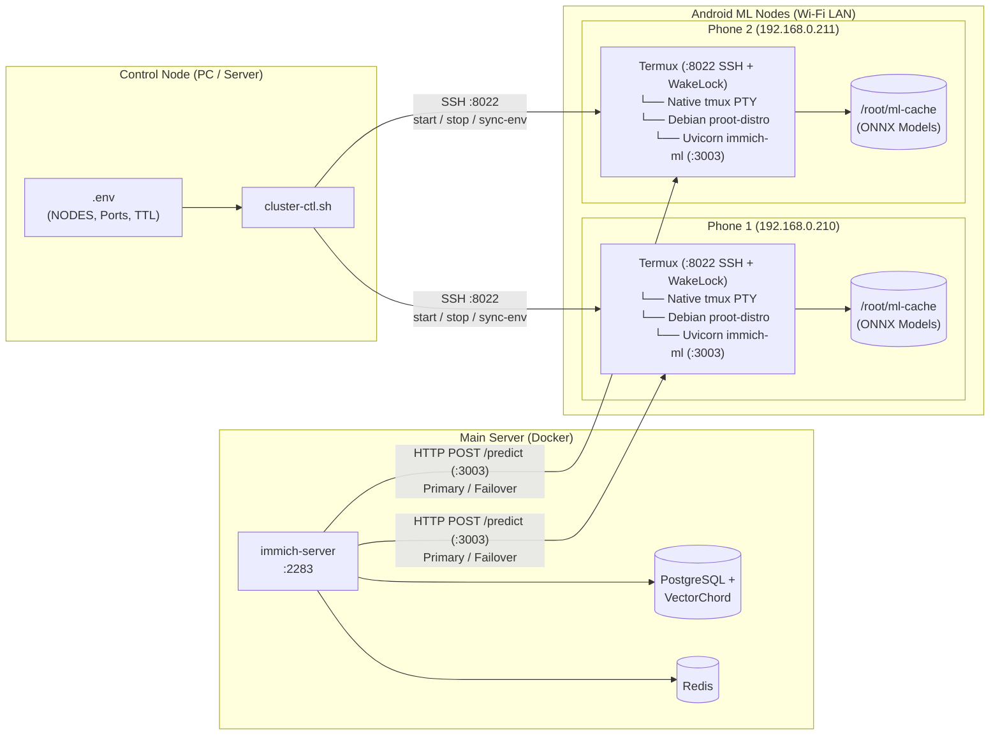
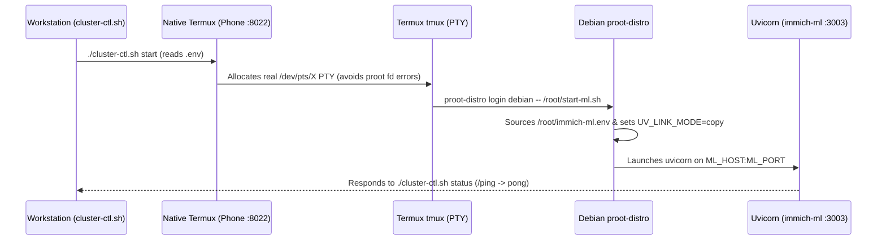

<div align="center">
  

# androidimmichml

  <p>
    <strong>Offload Immich machine learning workloads to idle Android smartphones using Termux and Debian PRoot.</strong>
  </p>

  <p>
    <a href="https://immich.app/"></a>
    <a href="https://termux.dev/"></a>
    <a href="https://www.debian.org/"></a>
    <a href="https://github.com/astral-sh/uv"></a>
    
    
  </p>
</div>

Offload your [Immich](https://immich.app/) Machine Learning (`immich-ml`) workloads (Smart Search CLIP indexing and Facial Recognition) to one or more unrooted Android phones using **Termux** and **Debian `proot-distro`**.

By running `immich-ml` inside a lightweight Debian `aarch64` userland on idle smartphones, you can turn off the resource-heavy `immich-machine-learning` Docker container on your main server while leveraging mobile ARM64 cores across your local network.

---

## Repository Structure

```text
androidimmichml/
├── .env               # Active environment configuration (addresses, ports, workers, TTL)
├── .env.example       # Template environment file for version control
├── .gitignore         # Prevents personal IPs/hosts in .env from being committed
├── README.md          # Complete documentation, architecture graphs, and troubleshooting
├── setup-phone.sh     # Automated installer run inside native Termux on each Android phone
└── cluster-ctl.sh     # Remote SSH cluster manager run from your workstation/server
```

---

## System Architecture



### Why `proot-distro` Instead of Raw Termux?

Android uses Google's **Bionic `libc`** rather than standard GNU **`glibc`**. Installing Python ML packages in raw Termux forces `onnxruntime`, `rapidocr`, and `opencv` to compile from C++ source, which frequently fails. A Debian `proot-distro` container provides a standard `glibc` (`manylinux_2_28_aarch64`) environment where `uv` installs precompiled ARM64 wheels in minutes—with near-zero CPU overhead once `onnxruntime` loads into memory.

---

## Process Lifecycle & Execution Flow



---

## Configuration (`.env`)

All host addresses, ports, Immich release tags, and runtime parameters live in `.env`. Both `setup-phone.sh` and `cluster-ctl.sh` automatically source this file:

| Variable                                  | Default                         | Description                                                                                            |
| :---------------------------------------- | :------------------------------ | :----------------------------------------------------------------------------------------------------- |
| `NODES`                                   | `"192.168.0.210 192.168.0.211"` | Space-separated list of phone SSH hostnames (from `~/.ssh/config`) or LAN IPv4 addresses.              |
| `SSH_PORT`                                | `8022`                          | Termux OpenSSH listening port on the Android devices.                                                  |
| `IMMICH_VERSION`                          | `"v3.4.1"`                      | Git tag of Immich to clone (must match your main `immich-server` version).                             |
| `ML_HOST`                                 | `"0.0.0.0"`                     | Bind address for the Uvicorn server inside Debian.                                                     |
| `ML_PORT`                                 | `3003`                          | Port exposed by `immich-ml` for HTTP inference requests.                                               |
| `MACHINE_LEARNING_CACHE_FOLDER`           | `"/root/ml-cache"`              | Persistent directory inside Debian where downloaded Hugging Face ONNX models are stored.               |
| `MACHINE_LEARNING_WORKERS`                | `1`                             | Number of Uvicorn worker processes (keep at `1` on mobile devices to avoid OOM kills).                 |
| `MACHINE_LEARNING_MODEL_TTL`              | `0`                             | Model idle timeout in seconds (`0` = never unload/shutdown; `300` = unload after 5m and auto-respawn). |
| `MACHINE_LEARNING_REQUEST_THREADS`        | `0`                             | FastAPI thread pool size (`0` = default 8 threads).                                                    |
| `MACHINE_LEARNING_MODEL_INTRA_OP_THREADS` | `0`                             | ONNX Runtime intra-op CPU threads (`0` = automatic; set to `2` or `4` to reduce phone heat).           |
| `TMUX_SESSION`                            | `"immich-ml"`                   | Name of the detached native Termux `tmux` session.                                                     |

---

## System Requirements

### Hardware Requirements

- **Architecture**: 64-bit ARM (`aarch64` / `arm64-v8a`). 32-bit ARM architectures are not supported.
- **RAM**:
  - **Minimum**: 6 GB physical RAM (sufficient for single-model inference or low-concurrency tasks).
  - **Recommended**: 8 GB+ physical RAM (recommended for concurrent Smart Search, facial recognition, and OCR pipelines).
- **RAM Plus / Virtual RAM / Swap**: **Must be turned OFF** (disable "RAM Plus", "Memory Extension", or virtual swap in your Android settings). Virtual RAM swaps memory pages to slow flash storage, introducing severe I/O latency bottlenecks, thermal spikes, and premature flash wear during tensor execution.
- **Storage**: At least 5 GB free internal flash storage (Debian rootfs: ~1.2 GB, Python virtual environment: ~1.5 GB, cached ONNX models: ~1.5-2.5 GB).
- **Network**: 5 GHz Wi-Fi or USB-Ethernet adapter with static LAN IP addresses or router DHCP reservations.
- **Power**: Continuous power supply. Using battery protection (capping charge at 80-85%) or bypass charging is strongly recommended to protect battery health during prolonged inference.

### Software Prerequisites

1. **Termux** installed from [F-Droid](https://f-droid.org/en/packages/com.termux/) or [GitHub Releases](https://github.com/termux/termux-app/releases) (do not use Google Play Store builds, which are deprecated).
2. **Disable Battery Optimization**:
   - Android Settings -> Apps -> Termux -> Battery -> **Unrestricted**.
3. **Version Matching**: Ensure `IMMICH_VERSION` in `.env` matches your main Immich server version.

---

## Tested Hardware & Validated Models

This project has been verified in production on the following hardware and model configurations:

### Verified Hardware Testbeds

| Device                    | Physical RAM | Virtual RAM (RAM Plus) | Role                      | Status   |
| :------------------------ | :----------- | :--------------------- | :------------------------ | :------- |
| **Samsung Galaxy S20+**   | 12 GB LPDDR5 | **Disabled (Off)**     | Primary ML Node           | Verified |
| **Samsung Galaxy S21 FE** | 8 GB LPDDR5  | **Disabled (Off)**     | Failover / Secondary Node | Verified |

> [!IMPORTANT]
> Both test devices were operated with **RAM Plus explicitly turned off**. Disabling virtual swap ensures all ONNX model weights and runtime tensor buffers remain in high-speed physical LPDDR memory, avoiding flash storage I/O stalls and preventing Android low-memory killer (LMK) paging storms.

### Verified Model Suite

The following standard Immich machine learning models were tested and validated across both devices:

- **Smart Search (CLIP)**: 32-bit model (`ViT-B-32` / standard 32-bit embedding model)
- **Facial Recognition**: `antelopev2` (Antelope model / InsightFace recognition and detection)
- **Optical Character Recognition (OCR)**: English Mobile model (`mobile` model for English text detection and recognition via RapidOCR)

All three models load, execute, and respond to Immich `/predict` API endpoints within standard latency windows on `MACHINE_LEARNING_WORKERS=1`.

---

## Step 1: Install Phone Node (`setup-phone.sh`)

On each Android smartphone, open **Termux**, clone the repository, and run the automated installer:

```bash
pkg update -y && pkg install -y git
git clone https://github.com/nicx17/androidimmichml.git
cd androidimmichml
chmod +x setup-phone.sh
./setup-phone.sh
```

The installer provisions a Debian `proot-distro` userland, installs Astral `uv`, clones the Immich repository, syncs precompiled ARM64 CPU wheels using `UV_LINK_MODE=copy`, and writes the auto-respawning `/root/start-ml.sh` daemon wrapper.

---

## Step 2: Enable Remote SSH on the Phone

After `setup-phone.sh` completes, configure credentials and start the OpenSSH daemon in native Termux:

```bash
# 1. Set a password for the Termux user (used for remote SSH access)
passwd

# 2. Prevent Android from sleeping the CPU during inference
termux-wake-lock

# 3. Start the OpenSSH daemon on port 8022
sshd
```

Find your phone's local IPv4 address in Android Settings (e.g., **Settings -> Network & internet -> Wi-Fi -> IP address**, such as `192.168.0.210`). Repeat this step on any additional phones you plan to add to the cluster.

---

## Step 3: Workstation Setup & Configuring `.env`

On your main workstation, control server, or PC, clone the repository and configure your environment:

```bash
git clone https://github.com/nicx17/androidimmichml.git
cd androidimmichml

# Create your active environment configuration from the template
cp .env.example .env
nano .env
```

### Filling Out `.env` Parameters

Open `.env` and verify the following key parameters:

```env
# 1. List all phone LAN IPs or SSH config aliases separated by a space
NODES="192.168.0.210 192.168.0.211"

# 2. Termux OpenSSH port on your phones (Termux default is 8022)
SSH_PORT=8022

# 3. Immich version tag (MUST match your main immich-server version)
IMMICH_VERSION="v3.4.1"

# 4. HTTP bind settings for the Uvicorn inference service
ML_HOST="0.0.0.0"
ML_PORT=3003

# 5. Worker count (keep at 1 on mobile devices to prevent RAM exhaustion)
MACHINE_LEARNING_WORKERS=1

# 6. Model memory TTL (0 = keep in RAM permanently; 300 = idle unload after 5m)
MACHINE_LEARNING_MODEL_TTL=0

# 7. CPU threading (0 = auto; set to 2 or 4 to reduce thermal throttling on phones)
MACHINE_LEARNING_MODEL_INTRA_OP_THREADS=0
```

Once configured, push the environment parameters to all phone nodes:

```bash
chmod +x cluster-ctl.sh
./cluster-ctl.sh sync-env
```

---

## Step 4: Launch & Monitor Cluster (`cluster-ctl.sh`)

From your workstation, launch and verify the cluster across all devices:

```bash
# Start immich-ml in background tmux sessions across all configured NODES
./cluster-ctl.sh start

# Check HTTP /ping health across all NODES (verifies ONLINE status)
./cluster-ctl.sh status

# Attach to live Uvicorn logs on a specific phone (press CTRL+B then D to detach)
./cluster-ctl.sh logs 192.168.0.210

# Push updated .env settings and restart services when parameters change
./cluster-ctl.sh restart

# Stop all phone nodes and release wake-locks
./cluster-ctl.sh stop
```

---

## Step 5: Connect Immich Web UI & Turn Off Server Container

### 1. Register Phone Endpoints in Immich Web UI

1. Open your Immich web interface and navigate to **Administration -> Settings -> Machine Learning Settings**.
2. Replace `http://immich-machine-learning:3003` with your primary phone URL:
   `http://192.168.0.210:3003`
3. Click **Add URL** and add your secondary phone for automatic high-availability failover:
   `http://192.168.0.211:3003`
4. Click **Save**.

### 2. Turn Off the Main Server ML Container

In your main Immich server's `docker-compose.yml`, comment out the `immich-machine-learning` service definition and recreate the containers:

```bash
docker compose up -d --remove-orphans
```

Your primary server will now route all facial recognition, Smart Search, and OCR requests directly to your smartphone cluster.

---

## Troubleshooting Reference

| Symptom / Error Message                                               | Root Cause                                                                                                          | Solution                                                                                                                                         |
| :-------------------------------------------------------------------- | :------------------------------------------------------------------------------------------------------------------ | :----------------------------------------------------------------------------------------------------------------------------------------------- |
| `failed to hardlink file ... Operation not permitted (os error 1)`    | Android SELinux blocks `link()` syscalls inside `proot` when `uv` links wheels from `/root/.cache/uv` into `.venv`. | Export `UV_LINK_MODE=copy`, delete `.venv` (`rm -rf .venv`), and re-run `uv sync --extra cpu --no-dev` (automated in `setup-phone.sh`).          |
| `need to install a library that provides Python.h for psutil`         | `uv sync` installs the `dev` dependency group (`locust` -> `psutil`) by default.                                    | Install `apt install -y python3-dev` and pass `--no-dev` to both `uv sync` and `uv run`.                                                         |
| `GPU device discovery failed ... Permission denied: "/sys/class/drm"` | ONNX Runtime probes `/sys/class/drm` at startup; Android blocks unprivileged access to DRM sysfs.                   | Safe to ignore. `--extra cpu` automatically falls back to ARM64 CPU execution.                                                                   |
| `INFO: Shutting down due to inactivity`                               | `MACHINE_LEARNING_MODEL_TTL` defaults to `300` seconds and sends `SIGINT` to the single Uvicorn worker.             | Set `MACHINE_LEARNING_MODEL_TTL=0` in `.env` (or keep `300`, as `/root/start-ml.sh` automatically loops and respawns the worker).                |
| `proot warning: can't sanitize binding "/proc/self/fd/0"`             | `proot-distro` was invoked over a non-interactive SSH pipe before a PTY was allocated.                              | Always start `tmux new-session -d` in **native Termux** wrapping `proot-distro login debian -- /root/start-ml.sh` (handled by `cluster-ctl.sh`). |
| `Warning: failed to install terminfo: InstallFailed`                  | Modern terminals (e.g., Ghostty) push custom terminfo entries over SSH, but Termux lacks `tic`.                     | Run `pkg install -y ncurses-utils` in native Termux and pass `TERM=xterm-256color` to `tmux`.                                                    |
